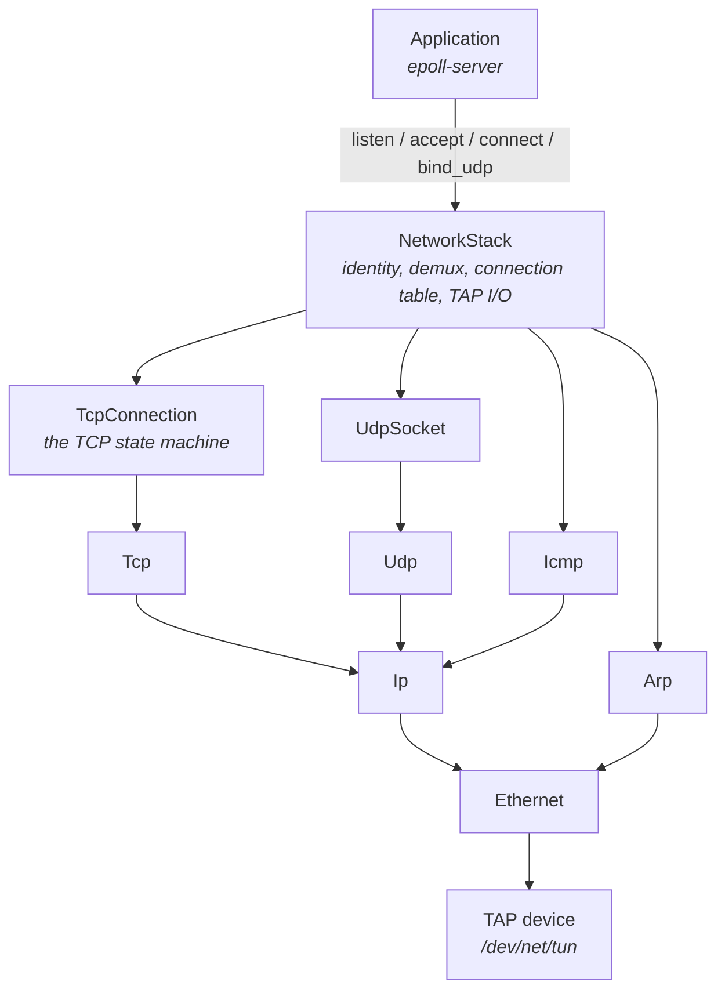

# A TCP/IP stack, from scratch

A userspace TCP/IP stack written in C++17: Ethernet framing, ARP, IPv4, TCP, UDP, and
ICMP, all hand-implemented over a Linux TAP device. No kernel sockets are involved in
the connections it serves. It runs against the real Linux kernel as a peer, and has
been verified doing so.

The point was to stop treating `send()` and `recv()` as opaque, and implement what the
kernel actually does underneath them.



## What it implements

**TCP.** The full RFC 793 state machine, including a real `CLOSING` state for
simultaneous close rather than folding it into `FIN_WAIT_2`. On top of that:

- A sliding window bounded by `min(cwnd, peer's advertised window)`, in bytes
- Slow start, congestion avoidance, and fast retransmit / fast recovery on three
  duplicate ACKs (RFC 5681) - with the growth and decrease policy itself behind an
  interface, and **two implementations: classic Reno and CUBIC** (RFC 8312), the latter
  the default because it is what Linux has run since 2006 and so what the peers on the
  other end of these connections are actually running
- **Adaptive retransmission timeout** (RFC 6298): round-trip time is sampled from the
  ack clock and smoothed with Jacobson and Karels' estimator, tracking both the mean
  and its variation, with Karn's algorithm rejecting the ambiguous samples that come
  from retransmitted segments and exponential backoff covering the resulting blind spot
- Out-of-order reassembly as disjoint byte ranges, so overlapping and partially
  overlapping segments are held once and keep every new byte, bounded by a fixed
  receive-buffer capacity that also determines the advertised window
- MSS and window scale negotiation (RFC 7323), including the rule that scaling applies
  only if *both* SYNs carried the option
- **Timestamps and PAWS** (RFC 7323): a round-trip sample from every segment rather than
  one per window, which restores RTT measurement *during* loss recovery - exactly when
  Karn's algorithm otherwise blinds the estimator - and rejects an old duplicate whose
  sequence number looks plausible because the space has wrapped
- **Selective acknowledgement** (RFC 2018), both directions. The cumulative ack can say
  "I have everything below this" and nothing else, so one lost segment hides the eight
  behind it that arrived perfectly; SACK names what did arrive, so only the holes are
  resent
- **SACK-based loss recovery** (RFC 6675) when SACK is negotiated: a per-segment
  scoreboard (`SendScoreboard`) with IsLost(), the pipe estimate and NextSeg() rules 1-4,
  rescue retransmission included; recovery entered on three duplicates or as soon as
  IsLost(HighACK+1) holds, and left at RecoveryPoint. After a timeout the SACK
  information is kept (section 5.1): every unSACKed segment is presumed lost and refilled
  in order, skipping what the peer holds. How much each ack may send during recovery is
  **Proportional Rate Reduction** (RFC 6937, with the slow start reduction bound), towards
  the ssthresh the Reno or CUBIC policy chose. Without SACK it is NewReno (RFC 6582):
  a partial ack resends the next hole and stays in recovery. Three losses in one flight
  cost three retransmissions and no timeout (`SimRecovery` in the test suite)
- **RACK-TLP** (RFC 8985) alongside it when SACK is negotiated. RACK detects loss by
  *time*: once a segment sent later has been delivered and a reordering window
  (min_RTT/4, or 0 in recovery) has passed, an earlier one is lost - a retransmission
  included, which RFC 6675's counting cannot see, so a lost retransmission no longer
  waits for the RTO. Candidates sit in a transmit-time list, so an ack costs what it
  changes rather than a walk of the flight however the peer shapes its SACK blocks, and
  a reordering timer catches what no ack would. A **Tail Loss Probe** handles the loss
  nothing follows: when an ack is overdue (2*SRTT, never later than the RTO) one probe
  goes out - new data, or the last segment again - so its SACK can tell RACK what is
  missing, and a loss the probe repaired by itself still reduces cwnd. In `SimRecovery`
  a lost retransmission now completes in 230 ms instead of 490 (no RTO), a lost tail in
  430 ms instead of 930, and 5% random loss over five seeds takes 2 RTOs instead of 12
- **ECN** (RFC 3168): negotiated on the SYNs, ECT(0) on new data only (never on SYNs,
  pure acks, retransmissions or probes), CE echoed as ECE until the sender's CWR, and
  ECE answered like a loss - the congestion-control policy's ssthresh - at most once per
  window, so an ECE flood earns one reduction per round trip. `NetworkStack::set_tcp_ecn()`
  takes Linux's `tcp_ecn` modes: 0 off, 1 ask and accept, 2 accept only - the default,
  as on Linux, since asking can meet middleboxes that drop ECN-setup SYNs. A simulated
  link that marks instead of dropping carries a transfer with no retransmissions while
  the window still comes down. Forwarding leaves the TOS byte, ECN field included, as it
  found it
- **Keepalive** (RFC 1122 4.2.3.6), off by default as the RFC requires, probing one byte
  *behind* SND.NXT because that is the only segment that compels a reply without moving
  the stream
- Delayed ACK and Nagle's algorithm, deliberately guarded against their well-known
  pathological interaction
- A zero-window persist timer, whose probe byte is intentionally kept outside the
  in-flight window so it cannot trip the retransmit give-up or the duplicate-ack
  machinery
- **Unpredictable initial sequence numbers** (RFC 6528): `ISN = M + F(4-tuple, secret)`,
  with a SipHash-2-4 keyed PRF for `F`. The clock term keeps successive connections on
  one 4-tuple ordered, exactly as RFC 793 intended; the keyed term means an attacker who
  can watch ISNs for their own 4-tuple learns nothing about anybody else's - which is the
  hole Morris described in 1985 and Mitnick used in 1994
- Checksum verification on receive, over the bytes *as received* rather than a
  re-serialization, and RFC 793 section 3.4 RST generation for segments matching no
  connection
- **Segment acceptance per RFC 9293 and RFC 5961.** In `SYN_SENT` a RST counts only if
  it acknowledges our SYN, and a bad ACK is answered with `<SEQ=SEG.ACK><CTL=RST>`;
  simultaneous open goes through `SYN_RECEIVED`, completing only from a segment at the
  expected sequence number (and, for the peer's SYN-ACK, with the options its SYN
  offered). On an open connection a RST resets only at exactly RCV.NXT, and an
  in-window RST off it, a SYN, or an ACK more than the peer's largest window behind
  SND.UNA draws a **challenge ACK** instead - throttled per stack to about 1000 a
  second, each second's limit randomised (Linux's CVE-2016-5696 fix), and counted
- **`TIME_WAIT` ignores RST** (RFC 1337): RFC 9293 still closes on one and names RFC
  1337 as optional; this stack takes its side, because closing early is the hazard
  `TIME_WAIT` exists to prevent
- `abort()` (RFC 9293 ABORT: a RST at SND.NXT, every queue flushed) alongside `close()`,
  which is a half close - `shutdown(SHUT_WR)`, not POSIX `close()`. After a ustack `close()`
  (`abandon_receive()`), new data from the peer is answered with a RST (RFC 9293 3.10.7.4),
  as is data left unread at close time; after `shutdown(SHUT_WR)` it is still delivered
- Data is sized so that payload plus options fits the MSS (RFC 6691); urgent data is
  delivered inline and URG is never sent (RFC 6093)
- A frame the device drops for a passing reason (`ENOBUFS`, `EAGAIN`, a link that is
  down) is counted as loss and recovered by retransmission rather than thrown at the
  application; only a device that is gone surfaces, as `FatalChannelError`

**IP.** Header parse and serialize, checksum computation and verification, and
fragmentation in both directions - splitting oversized outbound datagrams, and
reassembling inbound ones. Reassembly refuses overlapping fragments rather than
resolving them, which is the defence against the fragment-overlap evasion class,
and bounds how much a peer can make it hold for datagrams that never complete.

**ARP.** Request and reply in both directions, with a time-based TTL refreshed on
received traffic, so an actively-talking peer never ages out mid-conversation. The table
is bounded, and the stack only learns from ARP that targets its own address, so a shared
segment cannot fill it or overwrite mappings it is using. A newly configured address
(static, or from a DHCP bind) is announced as RFC 5227 section 2.3 describes: a broadcast
request with sender and target IP both the address, sent twice, 2 s apart, so neighbours
holding a stale mapping for it replace it. The RFC 5227 probe and conflict check before
binding is not implemented.

**Two transports.** A TAP device, or an `AF_PACKET` socket on a physical NIC, both behind
one `PacketChannel` seam that nothing downstream can distinguish. The real-NIC path
adopts the interface's own hardware address, which is what lets the card filter frames in
hardware and is why promiscuous mode is never needed. See
[docs/running-on-a-real-nic.md](docs/running-on-a-real-nic.md).

**UDP.** A connectionless `UdpSocket` with bind, `send_to`, and a receive callback.
Sending to a peer whose MAC is not yet known queues the datagram and kicks off a
bounded ARP resolution, the same way an active TCP open does.

**ICMP.** Echo Request and Reply (so a real `ping` gets an answer), Destination
Unreachable / Port Unreachable both generated and acted upon, and Time Exceeded for a
datagram whose fragments never all arrived. A datagram to this host with a protocol
nothing handles draws Protocol Unreachable (RFC 1122 3.2.2.1). A header whose option
list cannot be walked - a type octet with no length, a length under 2 or running past
the header - is discarded with Parameter Problem, the pointer naming the octet (RFC 792,
1122 3.2.2.5, 1812 4.3.2.7); unknown but well-framed options are ignored, and other bad
headers (version, IHL, length, checksum) are dropped silently. Every error obeys the same
rules (never about a broadcast, a non-first fragment or another error) and shares one
rate limit, and quotes the offending packet's header and first 8 bytes as received -
for a reassembled datagram, the first fragment's. Receiving a Destination Unreachable for a
connection's own segment fails that connection immediately instead of letting it grind
through the full retransmit budget.

**DHCP.** A full client (RFC 2131): DISCOVER, OFFER, REQUEST, ACK, then T1 renewal, T2
rebinding and lease expiry. It configures the stack itself - address, mask, gateway and
MTU arrive together and go straight into `configure_interface()`, which is why that had
to be reconfigurable before this could exist.

The two round trips are not redundant, and the three timers are not one timer with
decoration. The REQUEST is *broadcast* even though the client has already chosen a
server, because that is how the servers whose offers were declined learn to release the
addresses they had reserved. And T1 (unicast to the granting server) is separate from T2
(broadcast to any server) so that a dead DHCP server is a degradation rather than an
outage: the client keeps working for seven eighths of a lease while the network gets a
chance to notice.

Its parser is the most exposed one in the stack - tag/length/value with an
attacker-chosen length, accepted from any source, before the host even has an address,
with nothing in the protocol authenticating any of it. The fuzz suite points at it for
exactly that reason, and every option accessor is total: a wrong-sized option reads as
absent rather than as whatever is next in memory.

**DNS.** A stub resolver (RFC 1034/1035): A records over UDP, CNAME chasing, retry
across multiple servers, and a bounded TTL-respecting cache. Servers come from the DHCP
lease's option 6, so name resolution configures itself along with the address.

Two things here are worth more than the request/response plumbing. **Name compression**
is the format's one genuinely dangerous feature - a label byte with its top two bits set
is not a label but a 14-bit offset back into the same attacker-controlled buffer, which
is the source of essentially every DNS parser CVE. The defence is layered: a pointer must
point strictly *backwards* (so a cycle is impossible by construction, not merely bounded),
the jump count is capped, and the decompressed name is capped at 255 bytes. Deleting both
of the first two makes the parser hang on a 14-byte datagram, which the test suite
demonstrates.

**And the query is made hard to guess.** A DNS answer is an unauthenticated datagram and
whoever replies first wins, so an off-path attacker who can predict a query can poison
the cache. Both unknowns get real entropy from keyed SipHash streams: the transaction id,
and the UDP source port - a fresh random one per query rather than one fixed port, which
is what takes the attacker from 16 bits of guessing to ~32. That is the gap Kaminsky's
2008 work made unignorable. The two streams keep *independent* state, because sharing it
would collapse the two guesses back into one.

**Forwarding - a network element, not just a host.** With more than one interface and
`--second-device`, the stack relays packets between segments: TTL decrement, header
checksum recomputed, re-encapsulated out the link the route names. It shows up in a
`traceroute` as a hop, because expiring a TTL draws ICMP Time Exceeded **code 0** - the
code only a forwarding node can produce, as distinct from the code 1 a host sends for a
reassembly timeout. No route draws Net Unreachable.

Off by default: two interfaces do not mean wanting to relay between them, and on a
machine straddling two networks, forwarding nobody asked for is how a firewall quietly
becomes a bridge. Linux takes the same position with `net.ipv4.ip_forward`.

A forwarded packet goes out byte-for-byte apart from the TTL and its checksum. That is
not an optimisation - rebuilding it from the parsed form would silently shorten a TCP
segment carrying options this codec does not model, corrupting a connection the stack is
only supposed to be relaying. The source address is not rewritten either: a router
forwards, it does not translate, which is what lets the reply come back and what makes
every hop visible to a traceroute.

The forwarding decision is made from the IP header alone: the receive path parses a
packet's transport header only if it is addressed to this host. So a router relays a
protocol it has never heard of, or a TCP or UDP header its own codecs would reject,
exactly as it would any other packet; a malformed IP option is the one header error it
reports rather than relays.

**Routing.** A subnet mask, a default gateway, and a route table with longest-prefix
match, each route naming the interface to send by. Every send decides whether the destination is on-link, and so resolves the
destination itself, or off-link, and so resolves the gateway - the distinction between
the address in the IP header and the address the frame is sent to.

**Timers in real time, not in polling cycles.** The stack takes elapsed milliseconds
from its caller (`on_time_passed`) rather than counting timer ticks, so every timeout in
it means what its RFC says it means no matter how often, or how regularly, the
application gets round to calling. The distinction is not academic: a tick counter
conflates "how often am I polled" with "how much time has passed", so an event loop that
stalls for two seconds delivers one tick and the stack concludes half a second went by -
retransmissions then run late by exactly however overloaded the machine was.

**Timers driven by deadlines, not by a tick.** Measuring elapsed time fixed what a tick
*means*; it left how often one arrives. The epoll server used a 500 ms periodic timerfd,
so 500 ms was the resolution of every timer in the stack: a delayed ACK due 200 ms after
its data went out up to 300 ms late, the whole of RFC 1122's 500 ms ceiling, and a
retransmission at the 200 ms minimum RTO could wait as long again. And every tick walked
every connection to decrement countdowns that were almost never due - linear in the
connection table for nothing. So every timer is now the moment it is due rather than a
countdown. Each `TcpConnection` reports its earliest deadline whenever one is armed or
disarmed; `NetworkStack` keeps a min-heap of (deadline, connection id), and
`on_time_passed` runs only the connections at its front - 5 ns per call with 10,000 idle
connections, against 106 us when it walked them all. `ms_until_next_timer()` reports how
long until the earliest timer anywhere in the stack (connections, ARP, reassembly, DHCP,
DNS), and both applications sleep exactly that long: the epoll server (through
`ustack::RealDriver`) re-arms a one-shot timerfd after every pass of its loop and disarms
it when nothing is pending, so an idle server does not wake at all. Moving deadlines are cheap on purpose: an ack that pushes
the retransmit timer later pushes nothing onto the heap - the earlier entry surfaces,
finds nothing due, and is re-queued once per round trip. Heap entries name connections by
id, so one for a connection reaped in the meantime is recognised and dropped rather than
dereferenced.

**Congestion control as a policy, not as the protocol.** Until it was pulled behind an
interface, `TcpConnection` knew that a window halved on loss and grew by one MSS per RTT
- which are Reno's answers, not TCP's. The seam sits where the two algorithms actually
disagree, which is only two places: how far the window is cut on congestion, and how it
grows past `ssthresh`. Slow start, the fast-recovery bookkeeping and the
timeout-is-worse-than-duplicate-acks distinction are RFC 5681's and are shared. Linux's
`tcp_congestion_ops` draws the line in the same place for the same reason. CUBIC is what
proves the seam was cut correctly rather than shaped around Reno: its window is a cubic
function of *real time since the last congestion event*, a quantity this stack could not
express at all until its timers stopped counting the application's polling cycles.

**Flow control that exists rather than being advertised.** Received data waits in a
queue until the application reads it, so an application that stops reading genuinely
closes the window and stops the sender. The window is never *shrunk*, though (RFC 1122
4.2.2.16, RFC 9293 3.8.6): out-of-order data arrives inside the window already offered, so
it is held without pulling the right edge back, as Linux's `tcp_select_window` does. When it
did shrink by every buffered byte, each duplicate ACK carried a different window, failed RFC
5681's "window unchanged" test, and fast retransmit never fired between two of these stacks.
The sender also counts an ACK that SACKs new data as a duplicate (RFC 6675's definition), so
a peer that does shrink cannot block fast retransmit either.

**Ten segments in the first flight.** cwnd starts at RFC 6928's initial window,
min(10*MSS, max(2*MSS, 14600)), for Reno and CUBIC alike; with a one-segment start every
connection's first round trip waited out the peer's 200 ms delayed-ack timer. It falls back
to one segment after more than one SYN or SYN-ACK retransmission, restarts from
min(IW, cwnd) after an idle period longer than the RTO (RFC 5681 4.1), and the loss window
after a timeout stays one segment.

**Every segment carries its options.** One path builds every non-RST segment, so a
retransmission, a zero-window probe or a keepalive carries a timestamp (RFC 7323 3.2) and a
retransmitted SYN offers what the first did. The timestamp echoed follows RFC 7323 4.3
(the earliest unacknowledged segment's, the hole-filling retransmission's) and is taken only
from a segment that passed PAWS and the window check (5.3), so a spoofed out-of-window
segment cannot advance it and make PAWS drop the real ones. `send()` is bounded too and reports how much it
accepted, and `listen()` takes a backlog so the accept queue cannot be grown without
limit by a peer.

## Deliberately out of scope

These are documented decisions, not gaps that were missed:

- **No PRR or RACK-TLP without SACK, and no D-SACK or F-RTO.** Without SACK, recovery
  is NewReno's window inflation and loss is detected by duplicate counts alone; there is
  no SACK-less pipe estimate for PRR to work from. Without D-SACK, RACK's reordering
  window stays at min_RTT/4 (RFC 8985's reo_wnd_mult never grows), TLP judges a repaired
  loss without the D-SACK case, and a spurious retransmission or timeout is not undone.
- **ECN is RFC 3168's, not AccECN or L4S.** One reduction per marked window, no
  per-mark feedback (RFC 9768) and no DCTCP-style proportional response; a sender with a
  one-segment window does not also reset its retransmit timer on ECE (6.1.2).
- **No ECMP.** A route is keyed by destination and prefix, so two routes to one prefix by
  different interfaces cannot coexist. Equal-cost multipath needs a per-flow hash to keep
  a connection's packets on one path, which is a different project.
- **No ICMP Redirect.** When a packet would go back out the interface it arrived on, this
  stack declines to forward it rather than telling the sender about the better first hop.
  That is the safe half of the behaviour.
- **`TIME_WAIT` assumes a 30-second MSL**, so it runs for 60 seconds rather than RFC
  793's 4 minutes. Linux makes the same call, for the same reason: the RFC's figure was
  calibrated for a network whose delays no longer exist, and holding per-connection
  state that long is a real cost on a busy server.

## Building

Requires a Linux toolchain with C++17, CMake 3.20+ and Ninja. GoogleTest and GMock are
taken from the system package (`libgtest-dev libgmock-dev` on Debian/Ubuntu, `gtest` on
Arch) and fetched at a pinned release if none is installed. ccache is used when present.

The build is CMake, with one preset per flavour in `CMakePresets.json` - `debug`,
`release`, `asan`, `tsan`, `coverage` (clang) and `strict` (`-Wextra -Werror`) - each in
its own `build/<preset>` directory. The root Makefile is a thin wrapper over them:

```sh
make            # build everything (debug preset)
make test       # build and run the full test suite
make strict     # build everything with -Wall -Wextra -Werror, then run the tests
make coverage   # per-file coverage report; HTML in build/coverage/html
make clean

# or directly
cmake --preset debug && cmake --build --preset debug && ctest --preset debug -L unit
```

The presets build the stack, the test runner and both applications. The applications,
[`epoll-server/`](epoll-server/) and [`http-get/`](http-get/), also keep their own
Makefiles (`make -C epoll-server`), which is how the end-to-end scripts build them.

There is no native Linux requirement for the *tests* - they run anywhere, because every
component takes an injectable seam instead of touching the OS directly. Running the
stack itself needs `/dev/net/tun` and `NET_ADMIN`. A container works:

```sh
docker run --rm -it --cap-add=NET_ADMIN --device=/dev/net/tun \
    -v "$PWD:/work" -w /work gcc:latest bash
```

### Git hooks

Optional hooks in [`githooks/`](githooks/) catch what CI would catch, before you push:

- `pre-commit` checks the *staged* C/C++ files with `clang-format`, then runs `make test`.
- `pre-push` runs `make asan` (a full clean rebuild, so it is the slow one).

```sh
git config core.hooksPath githooks     # enable (per clone)
git commit --no-verify                 # skip pre-commit once
git push --no-verify                   # skip pre-push once
```

Needs `clang-format` on `PATH`. The static-analysis checks CI runs are in
[`.github/workflows/static-analysis.yml`](.github/workflows/static-analysis.yml); the
`clang-tidy` configuration is in [`.clang-tidy`](.clang-tidy).

## The applications on top

[`http-get/`](http-get/) is the demonstrator: a one-shot HTTP client that starts with **no
address at all** and does the entire job itself.

```
$ sudo http-get --transport nic --device vhttp0 --dhcp demo.stacktest:8080/index.html
interface vhttp0  mac e2:79:f3:b4:3b:8e
DHCP     discovering...
DHCP     10.9.1.56/24  gateway 10.9.1.1  lease 120s
DNS via  10.9.1.1
DNS      resolving demo.stacktest...
DNS      demo.stacktest is 192.168.88.10
TCP      connecting to 192.168.88.10:8080...
TCP      established
HTTP     GET /index.html
HTTP     24 bytes of body

HTTP/1.0 200 OK
...
```

Every line there is this project's own code: the DHCP exchange, the DNS query, the ARP
for the gateway (the server is off-link, so the frame goes to the router while the IP
header names the server), the handshake, and the half-close. The kernel's only
involvement is an `AF_PACKET` socket handing over raw Ethernet frames. `curl` does this
in one line - the point is that this is the same line with everything underneath it made
visible.

It runs in CI against real `dnsmasq` and a real HTTP server, neither of which has ever
heard of this codebase.

[`epoll-server/`](epoll-server/) is a multithreaded TCP echo server written against the
`ustack` socket API below, the way one is written against the kernel: accept, read, hand
the work to a thread pool, write the answer back, all in one epoll loop. The logic is a
template over the stack type, so the same source builds against this stack or, with
`make -C epoll-server KERNEL=1`, against real kernel sockets. Workers never touch the
stack (it is not thread-safe): they compute responses and hand them back through an
eventfd-backed completion queue that the reactor drains. It listens on several ports,
caps concurrent connections, and on SIGINT/SIGTERM flushes responses, half-closes every
connection and waits for the peers (up to 5 s). See its own README.

[`include/ustack/stack.h`](include/ustack/stack.h) is a socket API over the stack with
the kernel's names, signatures and constants - `socket`, `bind`, `listen`, `accept4`,
`connect`, `send`, `recv`, `sendto`, `recvfrom`, `shutdown`, `close`, `setsockopt`
(`TCP_NODELAY`, `SO_KEEPALIVE`, `TCP_USER_TIMEOUT`, `SO_LINGER`, `TCP_CONGESTION`,
`SO_ERROR`), plus its own `epoll_create1`/`epoll_ctl`/`epoll_wait` - returning -1 and
setting `errno` as Linux would. Its fds are indexes into its own table, not kernel fds.
The epoll is built like the kernel's: an interest list and a ready list filled by
callbacks from the stack, with level-triggered, `EPOLLET` and `EPOLLONESHOT` semantics.
It is non-blocking only (`socket()` requires `SOCK_NONBLOCK`), because the thread that
would block is the one that drives the stack; `epoll_wait()` is what runs it, through a
driver that waits on the channel fds and a timerfd, or on the simulator's virtual time in
tests. `pollable_fd()` lets it nest inside an application's own kernel epoll. The other
direction is `epoll_ctl_external()`: a kernel fd the application owns (an eventfd, say) is
added to a ustack epoll and the wait sleeps in the driver's kernel epoll until it is ready
(level-triggered; the simulator's driver refuses with `ENOTSUP`).

[`include/ustack/kernel_stack.h`](include/ustack/kernel_stack.h) is `ustack::KernelStack`:
the same method names and signatures, each forwarding to the real `::socket`,
`::epoll_wait` and so on. Code written as a template over the stack type compiles against
either, which is how the epoll server's tests run one set of scenarios on both, and how
`test_stack_differential.cpp` records the epoll events, bytes and errno values of one
scenario on each and compares them.

## Testing

Over 370 GoogleTest unit tests covering the protocol codecs, checksums, the TCP state machine, RTT
estimation, congestion control, flow control, keepalive, ISN generation, DHCP lease
acquisition and renewal, DNS parsing and anti-spoofing, routing, fragment reassembly,
ARP ageing, UDP, ICMP, the thread pool and completion queue, and the logger, plus a fuzz
suite asserting no codec crashes on malformed input.

Two seams make the untestable parts testable without any OS involvement: `PacketChannel`
injects a fake frame transport into `NetworkStack`, and `LoopbackChannel` wires two
complete stacks back to back through a real ARP exchange, handshake, data transfer, and
half-close.

### Simulator

`tests/include/sim/` is a deterministic network simulator. `SimNetwork` runs any number of
stacks on virtual time (`SimClock`; nothing reads the real clock) over `NetemChannel` links
that, per direction, lose, duplicate, corrupt, reorder, delay and jitter frames, serialize
them at a given rate behind a bounded queue, and drop frames over an MTU. Every decision comes
from one seeded `std::mt19937_64`, and each stack's secrets (ISN key and clock, SYN-cookie
key) are derived from the same seed through the `NetworkStack::set_secret_seed()` test seam,
so a seed reproduces a run byte for byte. A test can also pick a stack's secret seed itself,
which is how `SimTcp.ATransferCrossesTheSequenceNumberWrap` puts both ISNs just below 2^32.
Focused scenarios (a lost SYN-ACK, one lost segment, an odd MTU, the RTO under loss) live in
`test_sim_tcp.cpp`; `NetemChannel::set_drop_filter()` drops one chosen frame.

Virtual time advances event to event: each step jumps straight to the earliest of the next
frame due on any link and the next timer due in any stack (`ms_until_next_timer()`), so a
minute of TIME_WAIT is one step rather than 60,000. Nothing can happen in between, and
`SimNetworkTest.EventDrivenSteppingMatchesOneMillisecondSteppingFrameForFrame` holds it to
that: a lossy transfer, close and TIME_WAIT produce the same frames, byte for byte and at the
same microsecond, as stepping one millisecond at a time (`set_event_driven(false)`). A stack
that failed to report a deadline would make the two diverge at that frame.

- **Property tests** (`test_sim_transfer.cpp`, ctest label `sim`): per seed, a random link and
  a random payload of up to 1 MiB, sent one way or echoed; the bytes must arrive intact and in
  order and both connections must close. `make sim` runs `SIM_SEEDS` seeds (default 200, a
  few seconds) sharded over all CPUs; the nightly workflow runs 100000. Every seed that has
  ever failed is kept in `SimTransferRegression` (run by default) with what it found and
  which fix turned it green.
- **Conformance scripts** (`tests/scripts/*.pkt`): packetdrill-style scripts that play the peer
  of one stack - inject segments, state exactly what must come back and when. The syntax is
  documented in `tests/include/sim/pkt_runner.h`. `tests/scripts/pending/` holds scripts for
  behaviour not implemented yet; run them with
  `PKT_SCRIPTS=tests/scripts/pending ./build/debug/run_tests --gtest_filter='*PktScript*'`.

When a simulator test fails it writes `build/<preset>/sim-pcaps/<Suite>.<Test>.pcap` (frames as
delivered), `...tx.pcap` (as transmitted, so the difference is what the link dropped) and a
text rendering of each, and prints the paths - for the first `SIM_PCAP_LIMIT` failures (default
20; `make sim` splits it between shards). Later failures are only counted, so a regression in
the nightly run cannot upload hundreds of MB of captures of one bug.

```sh
make sim                                   # 200 seeds
SIM_SEEDS=100000 make sim                  # the nightly run
SIM_SEED_START=1055 SIM_SEEDS=1 make sim   # one seed again
```

### Integration tests

The components that cannot be unit tested are the ones that are nothing but syscalls -
the `AF_PACKET` and TAP transports, and the channel factory that opens them. It has an integration test instead, driving the whole stack over a
veth pair against a peer in its own network namespace. **This runs in CI on every push** -
it is the only test in the project with a real kernel on the other end, which is exactly
the class of bug the unit suite cannot reach (see "Verified against a real kernel" below).

```sh
sudo scripts/veth_test.sh       # one segment: the stack as a host
sudo scripts/router_test.sh     # two segments: the stack as a router between them
sudo scripts/http_get_test.sh   # DHCP + DNS + routing + TCP, against real servers
```

`router_test.sh` is the one that proves forwarding. Two namespaces sit either side of the
stack with no route to each other except through it, and the host kernel owns no address
on either network - so every packet that crosses is one this stack forwarded itself. A
TCP connection between the two real kernels traverses it intact, `traceroute` names the
stack as a hop, and the same process still terminates its own connections on both links
while relaying between them.

```sh
make test
make asan    # AddressSanitizer + UBSan + leak detection (rebuilds from scratch)
make tsan    # ThreadSanitizer (rebuilds from scratch)
./build/debug/run_tests --gtest_filter='TcpConnection.*'   # one suite
```

ASan, UBSan, and leak detection are clean, and CI runs them on every push, alongside
both compilers, a `-Werror` build of the stack and both applications, a coverage report,
and the end-to-end tests above. They are
worth more here than the pass/fail of the tests: two real bugs, a missing virtual
destructor on a class deleted through a base pointer and enums assigned from wire data
without a fixed underlying type, were both found this way while the entire suite was
passing.

`make tsan` proves something now, though it did not for a long time: while every test in
the suite was single-threaded, ThreadSanitizer could only observe sequential code and a
clean run meant nothing. The threaded code - `epoll-server`'s thread pool and completion
queue - is now built into the test runner and exercised under real contention, which
needs no TAP device and no privilege, only `eventfd`. Note also
that TSan aborts at startup ("incompatible memory layout", exit 66) wherever it cannot
disable ASLR. `make tsan` disables it via `setarch -R` when permitted; under Docker's
default seccomp profile the `personality()` syscall is blocked, so run it with:

```sh
docker run --security-opt seccomp=unconfined ...
```

### Load testing

`tools/loadgen` (built as `build/<preset>/loadgen`) is an epoll-driven echo client over the
kernel's sockets: C connections at a target rate (`--rate`) and concurrency, payloads of
`--size` bytes verified byte for byte, `--rounds` round trips per connection, N threads, or
`--duration S` for a sustained run. It prints connections/s, verified throughput, connect and
round-trip latency (p50/p90/p99/p99.9/max, log buckets about 3% wide) and errors by type
(refused, timeout, reset, early EOF, echo mismatch), as text or `--json`, and exits nonzero on
any failure. Unprivileged, against the kernel build of the server on loopback:

```sh
make -C epoll-server KERNEL=1 && ./epoll-server/epoll-server-kernel --port 18080 &
./build/debug/loadgen --port 18080 --connections 200 --concurrency 100 --size 4096 --rounds 5 --threads 2
```

Against the real stack, `sudo scripts/loadtest_netns.sh` runs epoll-server on a veth pair
with loadgen in the peer namespace (a burst, a sustained run, and one under `tc netem` loss and
delay) and writes JSON reports; the nightly workflow runs it and uploads them.

### Soak test

`tests/src/test_soak.cpp` keeps a `ustack::Stack` EchoServer and a client stack alive for two
virtual hours over a lossy, reordering, corrupting link while clients churn (echoes,
half-closes, resets, abandoned and idle connections, connects to a dead host, UDP to a closed
port, unanswered DNS), then stops and requires the resources back at baseline: both
connection tables, the timer heap, accept queues, UDP/resolver/ARP state and the server's
connection list empty, no growth between the first and last third of the run in table sizes,
reorder buffers or heap. It reads those private tables through `tests/include/sim/stack_probe.h`,
which needs no change to the stack. Event-driven time makes it about 45 s of real time.
`make soak` runs it (`SOAK_SEED`, `SOAK_MINUTES` vary it; ctest label `soak`), the nightly
workflow runs it with a rotating seed, and a two-minute `SoakSmoke` version is part of `make test`.

### Mutation testing

`make mutation` rebuilds the unit tests with clang and [Mull](https://mull.readthedocs.io)'s
plugin on `tcp_connection`, `send_scoreboard`, `reorder_buffer`, `ip` and `dns`, then runs the
suite once per mutant (a flipped comparison, `+` turned into `-`, ...). A surviving mutant is
a behaviour no test pins down. It needs `clang++-19` and the `mull-19` package from Mull's apt
repository (the plugin must match the compiler's LLVM exactly). It is slow, so it runs
nightly, publishes the mutation score in the job summary and uploads the report; there is no
threshold. The job and target were written from Mull's documentation and could not be run
where they were written, so the first nightly is also their first test.

### Verified against a real kernel

Unit tests are necessary but not sufficient here, and this project has a concrete
lesson about why. Every test used two instances of *this same stack*, which agreed with
each other about a checksum computed over a re-serialization of a parsed segment. The
Linux kernel does not agree, because a real SYN carries options this codec does not
model, so re-serializing it produces different bytes. Every real connection was being
rejected as a bad checksum, and no self-consistent test could ever have shown it.

So the stack is also driven end to end against the kernel: a TAP device in a privileged
container with the kernel side addressed, then exercised with `ping`, `nc`,
`tcpdump`, and a concurrent load test. That confirms ping, TCP echo, RST on a closed
port, UDP port unreachable, and 720 out of 720 load connections.

### Fuzzing

The unit suite's fuzz tests feed each parser a fixed set of random inputs. Real fuzzing
is coverage-guided: [libFuzzer](https://llvm.org/docs/LibFuzzer.html) keeps the inputs
that reach new branches and mutates those, which is what finds the inputs random bytes
almost never produce. [`fuzz/`](fuzz/) has one harness per parser (Ethernet, IPv4, TCP
with its options, UDP, ICMP, ARP, DHCP, DNS), one that feeds the IP reassembler a
sequence of fragments, and one stateful harness that feeds frames into a whole
`NetworkStack` with a listening port and an established connection, running `poll()` and
the timers between frames. Each has a small committed seed corpus in `fuzz/corpus/`,
generated from the stack's own serializers by `fuzz/gen_corpus.cpp`.

```sh
make fuzz                      # every harness, 30 s each (needs clang)
FUZZ_SECONDS=300 make fuzz     # longer
```

A crash leaves its reproducer in `build/fuzz/crashes/<harness>/`; replay it with
`./build/fuzz/fuzz/fuzz_<harness> <file>`. CI runs 20 s per harness on every push, and
the nightly workflow runs about 30 minutes in total with the grown corpus cached between
runs.

### Benchmarks

[`bench/`](bench/) holds [Google Benchmark](https://github.com/google/benchmark)
microbenchmarks (fetched at a pinned release): the Internet checksum at 64, 576, 1500 and
9000 bytes; parsing and serializing Ethernet + IPv4 + TCP with options; parsing a DNS
response with name compression; the TCP reorder buffer, including a many-gaps worst case;
the SACK scoreboard walk; and a simulated bulk transfer through the network simulator
(bytes per wall second, with no loss, 1% and 5% loss, and the simulated completion time
as `virtual_ms`).

```sh
make bench                                     # Release (-O2 -g)
make bench BENCH_ARGS=--benchmark_filter=Reorder
```

On every push to `main`, [`bench.yml`](.github/workflows/bench.yml) runs them and appends
the results to the `gh-pages` branch with
[github-action-benchmark](https://github.com/benchmark-action/github-action-benchmark),
which generates a chart per benchmark over commits. The charts are at
`https://KoganTheDev.github.io/tcp-ip-stack/dev/bench/`. A 1.5x slowdown against the
previous run fails the job and comments on the commit; the threshold is loose on purpose,
because shared runners are noisy. Pull requests run the benchmarks and show the
comparison in the job summary without publishing.

One-time setup for the repository owner: after the first run on `main` has created the
`gh-pages` branch, enable **Settings > Pages > Build and deployment > Deploy from a
branch > `gh-pages` / root**. Until then the numbers are recorded but there is no page.

## Performance

Profiled with `perf` and `callgrind` under concurrent load, not guessed at:

- `on_time_passed()` visited every connection on every timer tick to decrement its
  countdowns, nearly all of them for nothing: 106 us per call with 10,000 idle
  connections. The connection timers are now deadlines in a min-heap, so a call costs
  the timers that are due - 5 ns with the same 10,000 (`bench/bench_timers.cpp`).
- `_reap_closed_connections()` scanned every connection on every event-loop tick and
  was 13.1% of total self time, the single largest cost in the binary. Replaced with an
  event-driven queue fed by the existing state-change callback: O(closed since last
  reap) instead of O(every connection alive). It no longer appears in the profile.
- Per-field heap allocation in serialization: every header field went through a
  function that allocated a buffer just for the caller to copy and discard it, about 20
  times per packet. Replaced with in-place appends onto a pre-reserved buffer,
  cutting `malloc` from 7.3% to 5.2% and removing several allocator entries from the
  profile entirely.
- Receive-path parse cost cut roughly 56% (4.45B to 1.96B instructions under callgrind)
  by removing a hex-string parse from the address default constructors, a per-field
  allocation in `slice_int`, and payload copies through the parse path.

## License

MIT. See [LICENSE](LICENSE).
